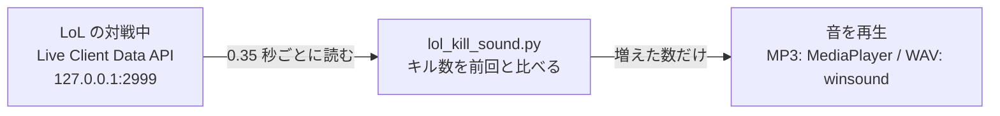

# LoL キル確認音

League of Legends の対戦中に、自分がキルを取ったら自分で用意した音を鳴らす Windows 向けのローカルツールです。

例: 自分のキル数が 3 → 4 に増えたら、音を 1 回鳴らす。一気に +2 なら 2 回鳴らす（最大 5 回）。

- ゲームには手を加えない（メモリ読み取り・DLL 注入・オーバーレイなし）
- 読むのは Riot 公式の Live Client Data API だけ（`127.0.0.1:2999`、自分の PC の中で完結）
- 外部ライブラリなし（Python 標準ライブラリと Windows の標準機能のみ）

仕組みと設計の判断は [SPEC.md](SPEC.md) にまとめています。

---

## 使い方

1. 音ファイルを `sounds/kill-confirm.mp3` として置く（音は同梱していません）
2. LoL の対戦（カスタム・プラクティスツールも可）に入る
3. `run.bat` を実行する。`Watching…` と出たら待機中
4. キルが増えるたびに音が鳴る。終了は `Ctrl+C`

LoL の起動に合わせて自動で見張りを始めたい場合は、`watch-lol-and-start.bat` を一度実行します。ログイン時から待たせるなら `install-startup-shortcut.bat` を使います。

---

## 仕組み



1. 対戦に入った時点のキル数を基準にする（この時点では鳴らさない）
2. 基準より増えていたら、増えた数だけ鳴らして基準を更新する
3. 対戦が終わって API に届かなくなったら、次の対戦を待つ

---

## 工夫したところ

- **ゲームに触らない**: 読むのは公式の Live Client Data API だけ。API キーは要らず、外部への通信もない（読み先は自分の PC）。
- **鳴らすのは増えた分だけ**: キル数の増加を見るので、対戦の途中から起動しても、起動前のキルでは鳴らない。
- **二重起動を防ぐ**: 自動起動ヘルパーは、見張りがすでに動いていれば起動しない。
- **実際の LoL なしでテスト**: API の応答はダミーに差し替えて pytest で確認する。GitHub Actions で push のたびに実行している。
- **追加インストールなし**: MP3 は Windows 標準の MediaPlayer、WAV は `winsound` で再生する。

---

## 手元で動かす

必要なもの: Windows、Python 3.10+（[python.org](https://www.python.org/downloads/) の公式インストーラを推奨。インストール時に「Add python.exe to PATH」にチェック）

```bat
run.bat --test-sound    # 音が鳴るか確認
run.bat --once-check    # 対戦データに届くか確認（対戦中に実行）
run.bat --poll 0.5      # 確認の間隔を変える（秒）
run.bat --sound sounds\my-kill.mp3
```

テスト:

```bat
pip install pytest
python -m pytest
```

---

## 構成

| ファイル | 役割 |
|---|---|
| `lol_kill_sound.py` | キル数の監視と再生 |
| `lol_autostart.py` | LoL の起動を見て、見張りを一度だけ起動する |
| `config.json` | 確認の間隔・デバウンス・音ファイルの場所 |
| `tests/` | pytest（API の応答はダミー） |
| `SPEC.md` | 仕様と設計の判断 |

---

## トラブルシューティング

- **対戦が検知されない**: API が開くのは対戦中だけ。ロビーやチャンピオン選択中は届かない。`run.bat --once-check` で確認する。
- **音が鳴らない**: `run.bat --test-sound` で確かめる。音量ミキサーでミュートされていないかも見る（MP3 は Windows PowerShell、WAV は python.exe として表示される）。
- **Python が見つからない / ウィンドウがすぐ閉じる**: Python を入れ直して PATH を通すか、`cmd /k run.bat` で起動してエラーを読む。

---

## 注意

- 音ファイルは同梱していません。使う権利のある音を自分で用意してください。このツールでゲームファイルから音を抽出・スクレイピングしないでください。
- Riot Games の公式製品ではありません。
